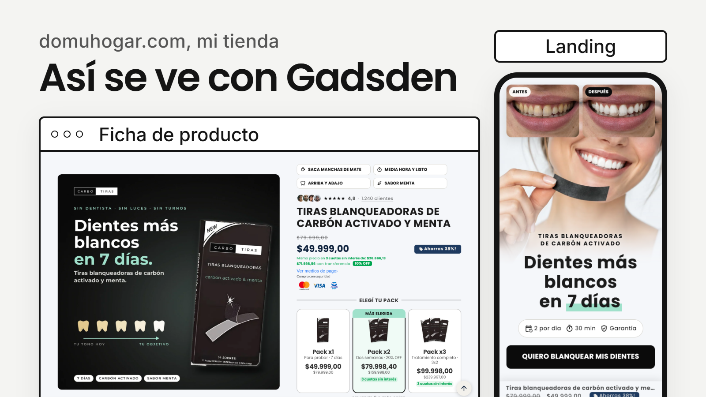

# Gadsden

Theme de Shopify basado en [Dawn](https://github.com/Shopify/dawn) 16.0.0, pensado para tiendas de un producto o de pocos productos que venden con landings: ficha de producto con bloques de conversión, carrito lateral armable por bloques y más de 30 secciones para armar páginas de venta sin tocar código.



**En vivo** en domuhogar.com (Gadsden 1.2.7): [landing y ficha de producto](https://domuhogar.com/products/carbotiras) · [colección](https://domuhogar.com/collections/all)

Es *white-label*: no trae marca ni textos de ninguna tienda. Todos los ajustes del editor están en castellano.

Trae dos estilos base, que se eligen en *Configuración del tema > Gadsden · Estilo*:
- **Clásico** (por defecto): la tipografía y los botones de la línea clásica de Dawn, con el texto al 90 % del color.
- **Ecom**: títulos compactos, botones y precios en negrita, campos y cantidades redondeados, botón de compra lleno con el precio.

`config/settings_data.json` trae además dos estilos de theme listos: **Clásico** (el de fábrica: Poppins en títulos e Inter en textos, botones con borde de 2 px y redondeo de 6, tarjetas y cajas con sombra suave y redondeo, texto centrado en las tarjetas, íconos de trazo fino y combinaciones de color neutras en blanco, grises y casi negro) y **Ecom** (Poppins, redondeos de 8 y 12, combinaciones con botón verde).

## Qué agrega a Dawn

**En todas las secciones**
- Colores propios por sección (además de las combinaciones de la paleta), con degradé o imagen de fondo.
- Palabras resaltadas en los títulos (lo que se marca en negrita toma el color de acento).
- Volanta (texto chico arriba del título) con color propio.
- Modo carrusel con flechas, puntos, arrastre, pase automático y cantidad por pantalla, por dispositivo. La vista de desktop empieza en 750 px o en 990 px (ajuste global).
- Mostrar sólo en mobile o sólo en desktop, y nombre de ancla para que un botón lleve hasta la sección.
- Íconos de Material Symbols por nombre.

**Ficha de producto**
- Galería con miniaturas abajo, a un costado u ocultas, flechas y paginación en mobile.
- Selector de variantes con muestras de color e imagen, barra de compra fija.
- Ofertas por cantidad con descuento en porcentaje o fijo, precios escritos a mano o con comodines, pastilla de beneficio, insignia y variante elegida por unidad.
- Bloque **Fragmento propio** para sumar código sin copiar la sección (ver *Desarrollo*).
- Bloques: reseñas destacadas, beneficios, separador, urgencia, íconos con texto, imagen, características, estrellas (también estilo Trustpilot), cupón con un clic, productos para sumar, video, sellos de pago, oferta combinada, regalos por cantidad, envío estimado, hitos del envío, botones a secciones, avatares de reseñas, campo personalizado y botón con enlace.

**Carrito lateral**
- Armado por bloques: barra de envío gratis, hitos con premios, cuenta regresiva, regalo automático o condicional, productos sugeridos, cupón, nota, términos para aceptar, sellos de pago, imagen, texto con ícono y código propio.

**Cabecera y pie**
- Link activo resaltado (pastilla, subrayado o negrita), ícono de carrito a elección, menú mobile debajo de la cabecera o como panel lateral, con título y acceso a la cuenta, mega menú de productos con imágenes.
- Lupa a la izquierda o a la derecha en mobile; ícono de la cuenta opcional en mobile.
- Barra de anuncios en carrusel con cupón para copiar y redes, visibilidad por producto.
- Pie con anchos propios, suscripción, producto y colección destacados, medios de pago elegidos.
- Logo secundario y cabecera transparente sobre el hero.

**Secciones nuevas**
Hero de diapositivas con video de fondo, barra de íconos, cinta deslizante (horizontal o vertical), slider de fotos y videos, antes y después, tabla comparativa, pestañas, testimonios, franja de logos, resultados en porcentaje, volver arriba, seguimiento de pedido, popup promocional con cupón, reproductor de música, ofertas combinadas, cambiador de colores, columnas armables, testimonios estilo red social, íconos con contenido, historias, hero con parallax 3D, tabla de planes, puntos sobre imagen, separador de secciones, unión de dos secciones, imagen comprable, reseñas estilo Trustpilot y grilla con ventanas.

**Secciones para landings**
Progreso de lectura, estilo propio de una página, oferta del producto, muro de reseñas, pósters con texto, pasos con cronómetro, pasos automáticos tipo historias, tarjetas desplegables con ventana, sellos animados, capítulos en video, reseñas en dos cintas con avatares, carrusel 3D de videos, garantía con anillo, cierre con resaltador, hero con palabra que rota, tarjetas con imagen recortada, aviso y datos legales, cuestionario con resultado por perfil y nota (advertorial) armada por bloques.

Las animaciones respetan "reducir movimiento" del sistema.

**Más en la v1**: puntos sobre imagen a todo el ancho con una ventana por punto, testimonios estilo red social con reacciones y comentarios, íconos con contenido en dos columnas, separadores con formas animadas y en dos capas, antes y después con caja de texto y manija con triángulos, resultados y tabla comparativa con más opciones.

**Más en la 1.1**: lista de colecciones con el título sobre la imagen, carrusel e imagen y título propios; tabla comparativa con el texto arriba y tilde parcial; cuestionario con resumen de respuestas; nota con estilo diario y temas; íconos con contenido con video o imagen y pulso; estilo de página con fuente del texto y etiqueta de oferta.

**Ajustes globales**
Estilo base, etiquetas de oferta con porcentaje, etiquetas propias por tag, estilos de tarjeta (también "con velo"), precio y título de la tarjeta, alineación de los títulos de página, íconos de redes redondos o cuadrados, trazo de los íconos, tipografía extra (por enlace), cursor y barra de scroll propios, idiomas de derecha a izquierda, ventana para cambiar de idioma, bloqueo por país y protección de contenido.

Gadsden no trae ningún tipo de seguimiento ni píxel.

## Instalación

Con [Shopify CLI](https://shopify.dev/docs/api/shopify-cli):

```bash
shopify theme push --unpublished --store tu-tienda.myshopify.com
```

O descargá el ZIP de la [última versión](https://github.com/peripequenho/gadsden-theme/releases/latest) y subilo desde *Tienda online > Temas > Agregar tema*.

## Desarrollo

```bash
shopify theme dev --store tu-tienda.myshopify.com
shopify theme check
```

`theme check` debe dar lo mismo que Dawn de base (0 errores).

**Código propio en la ficha.** El bloque *Fragmento propio* de *Información de producto* muestra uno de cinco snippets vacíos (`snippets/gad-slot-1.liquid` a `gad-slot-5.liquid`) y les pasa `block`, `product`, `section` y `product_form_id`. Shopify no deja mezclar bloques de theme (`@theme`, carpeta `blocks/`) con los bloques propios de una sección, así que ése es el camino para sumar algo a la ficha sin copiar `main-product`.

**Formulario de compra.** El formulario tiene un campo `name="id"`, así que `form.id` devuelve ese campo y no el atributo: para buscar el formulario por su id usá `form.getAttribute('id')`.

## Migrar desde otro theme

- Las combinaciones de color se arman en *Configuración del tema > Colores*. Si el theme anterior pintaba el fondo de la imagen de las tarjetas de producto con el esquema de las tarjetas de colección, copiá ese esquema en *Tarjetas de producto > Combinación*.
- Si venías de un theme con medidas en saltos de 2 o 4 px, acá todos los rangos van de a 1 px: los valores se cargan tal cual.

## Apoyá el proyecto

Gadsden es gratis y lo va a seguir siendo. Si te ahorra horas de laburo, podés invitarme un cafecito en [cafecito.app/elcucholg](https://cafecito.app/elcucholg). El link también está en *Configuración del tema > Gadsden · Apoyá el proyecto* y en *Información del tema*.

Y como en los README de los jueguitos de antes, adentro de `layout/theme.liquid` hay una serpiente. Shopify la descarta al renderizar: no llega a la tienda.

```text
             OOOOOOOOOOO
         OOOOOOOOOOOOOOOOOOO
     OOOOOOOO OOOOOOOOOOOOOOOO
>---    OOOOOOOOOOOOOOOOOOOOOOOOO
     OOOOOOOOOOOOOOOOOOOOOOOOOOOOOOO
                 OOOOOOOOOOOOOOOOOOOOOOO
                              OOOOOOOOOOOO
                                  OOOOOOOOOO
                                     OOOOOOOOO
                                       OOOOOOOO
                                        OOOOOOOO
                                         OOOOOOOO
                                          OOOOOOOO
                                          oOOOOOOO
                     ooooooooooooooooooo  ooOOOO
                ooooooooooooooooooooooooo  oOOOOOOO
              oooooooooooooooooooooooooooo  OOOOOOOO
            oooooooooooooooooooooooooooooo  OOOOOOOO
           oOOOOOOoooo                 ooo  OOOOOOOO o
           OOOOOOO                        OOOOOOOOO  oo
           OOOOOOOO                     OOOOOOOOOO  ooooo
           OOOOOOOOOOO               OOOOOOOOOOOO  OOOOOO
         o  OOOOOOOOOOOOOOOOOOOOOOOOOOOOOOOOOOO  OOOOOOOOO
       ooooo  OOOOOOOOOOOOOOOOOOOOOOOOOOOOOOO     OOOOOOOO
      oOOOOOoo   OOOOOOOOOOOOOOOOOOOOOOOOO       OOOOOOOOO
     oOOOOOOOOo       OOOOOOOOOOOOOO             OOOOOOOOO oo
     OOOOOOOOO                                 OOOOOOOOOO  ooo
      OOOOOOOOO                              OOOOOOOOOOO  oooo
      OOOOOOOOOOOO                       OOOOOOOOOOOOOO  oOOOoo
       OOOOOOOOOOOOOOOOOO        OOOOOOOOOOOOOOOOOOOO  oOOOOOOO
         OOOOOOOOOOOOOOOOOOOOOOOOOOOOOOOOOOOOOOOOOO    oOOOOOOOO
            OOOOOOOOOOOOOOOOOOOOOOOOOOOOOOOOOOO         OOOOOOOO
               OOOOOOOOOOOOOOOOOOOOOOOOOOOO              OOOOOOO
                      OOOOOOOOOOOOOO                     OOOOOOOO
                                                          OOOOOOO
                                                          OOOOOOO
                                                          OOOOOOO
                                                          OOOOOO
                                                          OOOOO
                                                          OOOO
                                                         8888
                                                         888
                                                        888
                                                         8

                N  O     M  E     P  I  S  E  S

  G A D S D E N  ..  theme libre para Shopify
  ---------------------------------------------
  Hecho por Gero en Tucuman, entre mate y madrugada.
  Es gratis y lo va a seguir siendo: sin version pro,
  sin licencia por tienda, sin letra chica.

  Si te ahorra horas de laburo, invitame un cafecito:
      https://cafecito.app/elcucholg

  Codigo, issues y novedades:
      https://github.com/peripequenho/gadsden-theme

  Saludos a los que leen los comentarios del codigo.
  Son pocos, pero son los mejores.
```

## Licencias

- El código de Dawn se distribuye bajo la licencia de Shopify (`LICENSE-DAWN.md`), que permite usarlo para hacer themes de Shopify.
- Lo que agrega Gadsden está bajo licencia MIT (`LICENSE.md`).
- La fuente Material Symbols (`assets/material-symbols-outlined.woff2`) es de Google, bajo licencia Apache 2.0.
